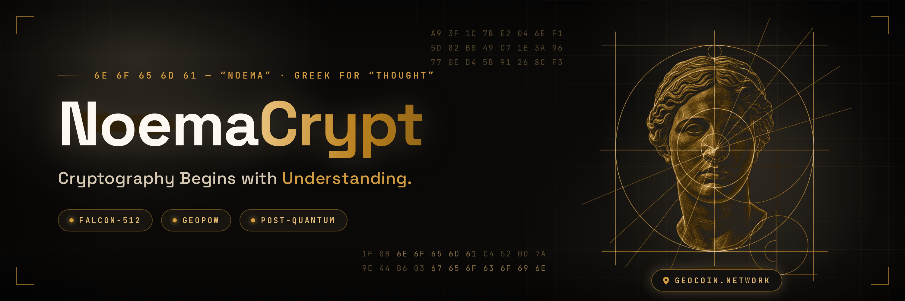
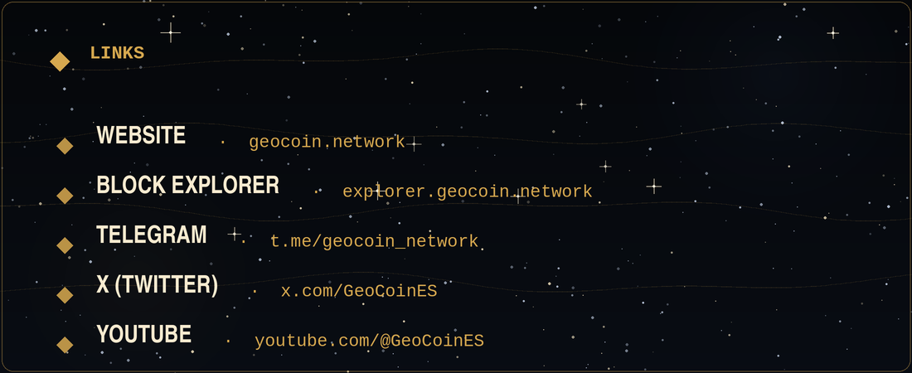
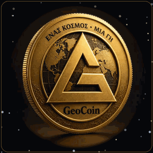

  

**NoemaCrypt** is the organization behind [GeoCoin](https://geocoin.network/) — infrastructure for verifiable digital assets and georegistered ledgers. We build the technological foundation for services and registries where data verifiability and independent validation matter.

## 🟢 Status

**Mainnet is live.** The public mainnet (`degree`) launched on **September 26, 2026** — read the [launch announcement](https://github.com/NoemaCrypt/.github/discussions/2) or watch live blocks in the [explorer](https://explorer.geocoin.network/).

## What we build

- **GeoCoin Network** — a live proof-of-work blockchain with GeoPoW consensus, UTXO model and a C++ full node (mainnet `degree`)
- **Post-quantum cryptography** — Falcon-512 transaction signatures, ready for the quantum era
- **Developer tooling** — JSON-RPC API, `libgeo` SDK for external applications and a Qt desktop wallet
- **Applications** — payments, digital registries, cadastral records, NFTs, multi-signature, delegation and sidechains

## Links

<table>
<tr>
<td width="62%" valign="top">

</td>
<td width="42%" valign="top">

</td>
</tr>
</table>

