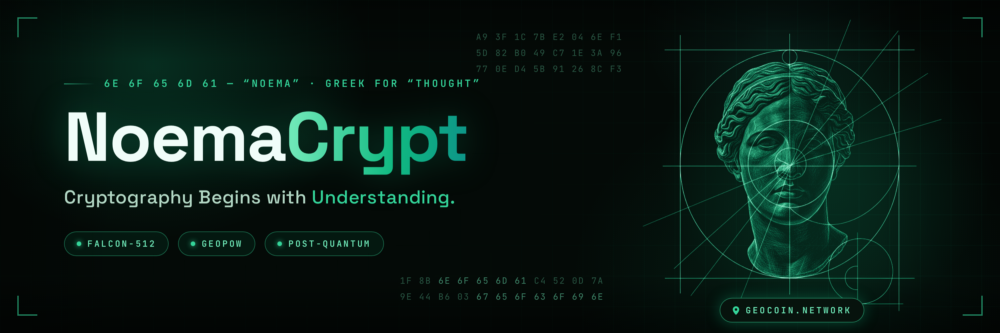

  

# NoemaCrypt

> **Cryptography Begins with Understanding.**

**NoemaCrypt** is the organization behind [GeoCoin](https://geocoin.network/) — infrastructure for verifiable digital assets and georegistered ledgers. We build the technological foundation for services and registries where data verifiability and independent validation matter.

## What we build

- **GeoCoin Network** — a proof-of-work blockchain with GeoPoW consensus, UTXO model and a C++ full node
- **Post-quantum cryptography** — Falcon-512 transaction signatures, ready for the quantum era
- **Developer tooling** — JSON-RPC API, `libgeo` SDK for external applications and a Qt desktop wallet
- **Applications** — payments, digital registries, cadastral records, NFTs, multi-signature, delegation and sidechains

## Links

- **Website:** https://geocoin.network/
- **Block explorer:** https://explorer.geocoin.network/
- **Telegram:** https://t.me/BFBby
- **X (Twitter):** [@GeoCoinES](https://x.com/GeoCoinES)

